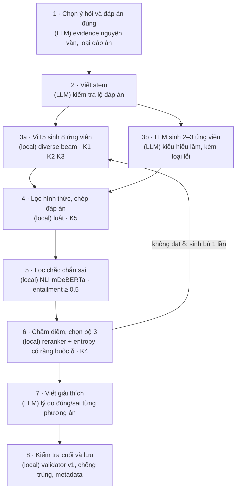

# Kế hoạch phiên bản 2: mô hình sinh đáp án nhiễu tiếng Việt

> **Điều chỉnh kế hoạch (06/11/2026):** hệ thống dùng trực tiếp ViT5 giai đoạn 1 (huấn luyện trên VSMRC, λ = 1, epoch tốt nhất là 1). Giai đoạn 2 không thực hiện vì ngân hàng câu hỏi quá nhỏ (219 câu huấn luyện, nhãn do LLM sinh và người chấm cho điểm hợp lý của đáp án nhiễu chỉ khoảng 3,0/5). Hệ quả: cấu hình C3 bỏ, C4 dùng ViT5 giai đoạn 1 + LLM. Dữ liệu 9 chương NLP (id 14–22) chuyển sang làm tập đánh giá, trong đó chương 4 và 9 (id 17, 22) không dùng khi huấn luyện. Đáp án nhiễu của câu v1 do một người chấm; không tính được kappa.


Cập nhật: 03/11/2026

## 1. Mục tiêu và phạm vi

Phiên bản 2 thêm một mô hình ViT5 tự fine-tune để sinh 5–8 ứng viên đáp án nhiễu cho mỗi câu, rồi chọn ra 3 phương án bằng entropy có ràng buộc. LLM vẫn giữ phần cần suy luận. Dự kiến làm trong 5 tuần (mục 10).

**Trong phạm vi:**

- Fine-tune một mô hình sinh đáp án nhiễu tiếng Việt qua 2 giai đoạn: dữ liệu chung, rồi dữ liệu môn NLP.
- Pipeline mới gồm: sinh ứng viên, lọc chép đáp án, lọc NLI, chấm điểm, chọn bộ 3 bằng entropy, LLM viết giải thích.
- Lưu metadata cho từng phương án: nguồn sinh, điểm, lý do bị loại.
- Bảng so sánh 5 cấu hình, từ phiên bản 1 tới pipeline đầy đủ.

**Ngoài phạm vi:**

- Thay LLM ở các bước chọn ý hỏi, viết đáp án đúng, viết stem, mô tả ảnh slide và chatbot RAG.
- Kho khái niệm và item analysis từ bài làm thật. Hai phần này nằm trong bản đề xuất trước, làm sau nếu còn thời gian.
- Giao diện: chỉ thêm những gì cần để hiển thị giải thích theo từng phương án.

## 2. Kỹ thuật lấy từ bài Chung et al. 2020

Có 5 kỹ thuật được áp dụng, 2 kỹ thuật không áp dụng. Mỗi kỹ thuật áp dụng đều có một điểm chỉnh sửa để hợp với bài toán slide, và đó là phần đóng góp riêng của bạn.

| # | Kỹ thuật trong bài | Áp dụng vào v2 | Chỉnh sửa so với bài gốc | Nằm ở |
| --- | --- | --- | --- | --- |
| K1 | **Answer negative loss** (unlikelihood trên token đáp án đúng) | Loss khi fine-tune ViT5: cross-entropy cộng λ · unlikelihood | Chỉ phạt token nội dung có trong đáp án đúng nhưng không có trong stem, bỏ từ dừng. Tránh phạt nhầm thuật ngữ dùng chung như "mô hình" hay "vector" | `training/kaggle/train_ddp.py` (UnlikelihoodLoss) |
| K2 | **Quét hệ số của loss phụ** (bài quét γ từ 1 đến 7) | Quét λ ∈ {0; 0,5; 1; 2} | Báo cáo đánh đổi giữa số ứng viên chép đáp án và độ giống với đáp án tham chiếu | notebook `kaggle_train_ddp.ipynb` (cell quét λ) |
| K3 | **Lấy ứng viên từ nhiều nguồn** (bài dùng 3 biến thể BDG) | 2 nguồn: ViT5 fine-tune (5–8 ứng viên) và LLM (2–3 ứng viên kiểu hiểu lầm) | Nguồn khác nhau về bản chất (model nhỏ vs LLM), không chỉ khác cách huấn luyện. Model còn dùng diverse beam search để các ứng viên không lặp ý | `app/generation/candidates.py` |
| K4 | **Chọn bộ 3 bằng cực đại entropy** (BDG\_EM) | Chọn 3 trong các ứng viên đã qua lọc | Thêm ràng buộc đáp án đúng phải thắng rõ (δ). Suy xác suất từng bộ từ một lần chấm theo tiên đề Luce, thay vì chạy model giải cho mọi bộ. Bài gốc không có ràng buộc này | `app/generation/selector.py` |
| K5 | **Hai cách đo của bài**: số đáp án nhiễu trùng đáp án đúng (> 0,95) và độ chính xác của mô hình trả lời trắc nghiệm | Dùng làm luật lọc trong pipeline và làm chỉ số trong bảng so sánh | Thêm điều kiện: mô hình giải có ngữ cảnh vẫn phải chọn đúng gần 100%. Nếu không, độ chính xác thấp có thể là do câu sai chứ không phải do đáp án nhiễu hay | `app/generation/validator.py`, `eval/v2/` |

**Không áp dụng:**

- **P-MLM (học đa nhiệm vụ đoán song song).** Nó sinh ra để mô hình nắm ý chính của bài đọc dài trong RACE. Slide là các ý ngắn, và ViT5 là mô hình encoder–decoder nên đã đọc toàn bộ ngữ cảnh qua encoder.
- **Sinh từng token bằng \[MASK\] trên BERT.** Dùng ViT5 có sẵn decoder thì đơn giản và ổn định hơn. Nếu hội đồng yêu cầu tái hiện sát bài, có thể thêm PhoBERT theo kiểu này làm baseline ở tuần 5.

## 3. Tổ chức lại thư mục

Toàn bộ code v1 chuyển nguyên trạng vào `legacy/v1/` và vẫn chạy được độc lập. v2 nằm ở thư mục gốc, bắt đầu từ một bản sao của v1 rồi chỉ thay phần sinh câu hỏi.

**Các bước:**

1. Commit trạng thái hiện tại và gắn tag `v1.0`, để luôn quay lại được bằng git.
2. Chép `app/`, `ui/`, `eval/`, `migrations/`, `docker/`, `requirements/`, `config.yaml`, `docker-compose.yml` vào `legacy/v1/`.
3. Trong `legacy/v1/docker-compose.yml`, đổi tên project và cổng (API 8001, UI 8502, DB 5433) để chạy song song với v2 khi cần so sánh.
4. Ở thư mục gốc, thêm các thư mục và file mới theo cây dưới đây.

```text
Project_NLP/
├── legacy/v1/                  # bản v1 nguyên trạng, chạy độc lập
├── app/                        # API v2 (kế thừa v1)
│   ├── generation/
│   │   ├── bank_builder.py     # SỬA: gọi pipeline mới
│   │   ├── candidates.py       # MỚI: ứng viên từ ViT5 + LLM (K3)
│   │   ├── filters.py          # MỚI: lọc chép đáp án (K5), lọc NLI
│   │   ├── selector.py         # MỚI: chấm điểm + entropy có ràng buộc (K4)
│   │   ├── explainer.py        # MỚI: LLM viết giải thích từng phương án
│   │   ├── validator.py        # SỬA: thêm luật
│   │   └── quiz_sampler.py     # SỬA: xáo và cân vị trí đáp án khi tạo đề
│   ├── local_models/           # MỚI: nạp ViT5, NLI, reranker một lần, dùng chung
│   └── prompts/                # TÁCH mcq_user.txt thành mcq_key, mcq_stem,
│                               #      mcq_misconception, mcq_explain
├── training/                   # MỚI: mọi thứ để fine-tune
│   ├── data/raw/  data/processed/
│   ├── prepare_data.py         # chuẩn hoá 3 bộ dữ liệu → JSONL chung
│   ├── export_bank.py          # xuất câu đã duyệt từ DB → dữ liệu giai đoạn 2
│   ├── losses.py               # CE + unlikelihood (K1)
│   ├── train.py                # Seq2SeqTrainer, đọc configs/*.yaml
│   ├── sweep.py                # quét λ (K2)
│   ├── evaluate.py             # BLEU/ROUGE, tỉ lệ chép đáp án, độ đa dạng
│   ├── configs/stage1.yaml  stage2.yaml
│   └── notebooks/kaggle_train.ipynb
├── checkpoints/                # model đã fine-tune (không đưa vào git)
├── eval/mcq/                   # giữ quy trình chấm hai người của v1
├── eval/v2/                    # MỚI: chạy bảng so sánh cấu hình
├── ui/  migrations/  docker/  requirements/  config.yaml  docker-compose.yml
└── Paper/  docs/  slides/  data/
```

`checkpoints/` được mount vào container API giống cách `hf-cache` đang làm. Huấn luyện chạy trên Kaggle, sau đó chỉ cần chép thư mục model về `checkpoints/`.

## 4. Các mô hình sử dụng

Chỉ có một mô hình phải fine-tune là ViT5. Các mô hình local còn lại dùng sẵn; riêng reranker và embedding đã có trong `config.yaml` của v1.

| Vai trò | Mô hình | Fine-tune? | Ghi chú |
| --- | --- | --- | --- |
| Sinh ứng viên đáp án nhiễu | [ViT5-base](https://arxiv.org/abs/2205.06457) (`VietAI/vit5-base`, khoảng 310 triệu tham số) | **Có**, 2 giai đoạn | Pretrain trên tiếng Việt của CC100. Fine-tune được trên GPU Kaggle (T4/P100) với fp16 |
| Mô hình dự phòng để so sánh | [BARTpho-syllable](https://huggingface.co/vinai/bartpho-syllable) (VinAI) | Có, chỉ giai đoạn 1 | Dùng nếu ViT5 kém, hoặc để có thêm một dòng trong bảng so sánh |
| Lọc "chắc chắn sai" | `MoritzLaurer/mDeBERTa-v3-base-xnli-multilingual-nli-2mil7` | Không | NLI đa ngôn ngữ, có tiếng Việt qua XNLI |
| Chấm điểm cho bước chọn bộ 3 | `BAAI/bge-reranker-v2-m3` | Không | Đã có trong v1. Có thể thay bằng LLM có logprob khi cần chính xác hơn |
| Embedding (độ đa dạng, chống trùng) | `BAAI/bge-m3` | Không | Đã có trong v1 |
| Chọn ý hỏi, đáp án đúng, stem, giải thích; sinh 2–3 ứng viên kiểu hiểu lầm | LLM hiện tại (`mcq_generator`) | Không | Như v1 |
| Model giải độc lập (đánh giá) | `judge_independent` trong config | Không | Dùng trong pipeline và trong bảng so sánh |

**Bộ nhớ khi chạy API:** ViT5-base, NLI và reranker cộng lại cỡ 1,2 tỷ tham số. Với fp16 trên GPU thì cần khoảng 3–4 GB VRAM. Chạy CPU vẫn được nhưng mỗi câu chậm hơn vài giây. Đây là ước lượng, cần đo thật ở tuần 4.

## 5. Dữ liệu

Giai đoạn 1 dùng 3 bộ trắc nghiệm tiếng Việt công khai, tổng khoảng 24 nghìn câu, tức cỡ 60–70 nghìn mẫu huấn luyện. Giai đoạn 2 dùng các câu đã được người duyệt trong ngân hàng câu hỏi môn NLP.

### 5.1 Nguồn dữ liệu

| Bộ | Quy mô | Nội dung | Ai viết đáp án nhiễu | Cách lấy | Dùng cho |
| --- | --- | --- | --- | --- | --- |
| [VSMRC](https://arxiv.org/abs/2506.15978) (2025) | 16.347 câu, sẵn chia train 11.442 / dev 3.269 / test 1.636 | Wikipedia tiếng Việt; 4 loại câu: kiểm tra sự kiện, điền chỗ trống, suy luận, liệt kê | Gemini 2.0 Flash Lite, kiểm lại bằng 2 LLM và chuyên gia. Khi chuyên gia kiểm tra ngẫu nhiên, 4,58% bị đánh dấu đáp án nhiễu kém | [Hugging Face, tổ chức VSMRC](https://huggingface.co/VSMRC); bài báo không nêu giấy phép | Giai đoạn 1, nguồn chính |
| [ViMMRC 2.0](https://arxiv.org/abs/2303.18162) | 5.273 câu, 699 bài đọc | Văn học lớp 1–12; một số câu chỉ có 2–3 lựa chọn | Người viết (lấy từ sách và đề thi) | Ký đơn xin dữ liệu với nhóm UIT; chỉ dùng cho nghiên cứu | Giai đoạn 1 |
| [ViMMRC 1.0](https://arxiv.org/abs/2001.05687) | 2.783 câu, 417 bài đọc | Văn học tiểu học | Người viết | Như trên; cần kiểm tra trùng lặp với bản 2.0 | Giai đoạn 1 |
| Ngân hàng câu hỏi của bạn | Vài trăm câu (sẽ đếm ở tuần 1) | Slide môn NLP, nhiều thuật ngữ tiếng Anh | LLM v1 sinh, người chấm duyệt | `training/export_bank.py` xuất từ DB | Giai đoạn 2 và tập test đúng miền |

**Lưu ý về nguồn:**

- VSMRC chiếm phần lớn dữ liệu và do LLM sinh. Mô hình vì vậy sẽ phần nào học lại cách viết của Gemini. Cần nêu trong phần hạn chế của báo cáo.
- Bảng so sánh nên có thêm một cấu hình chỉ huấn luyện trên dữ liệu do người viết (ViMMRC). Như vậy sẽ thấy được ảnh hưởng của dữ liệu tổng hợp.
- Gửi đơn xin ViMMRC ngay tuần 1, vì có thể mất vài ngày mới được duyệt.

### 5.2 Định dạng chung (JSONL)

Mỗi cặp (câu hỏi, một đáp án nhiễu) là một dòng. Một câu có 3 đáp án nhiễu thì cho 3 dòng, giống cách bài Chung et al. dùng RACE.

```json
{"id": "vsmrc-train-000123-d1", "source": "vsmrc", "split": "train",
 "group": "wiki:12345",
 "context": "…đoạn văn đã cắt theo độ liên quan…",
 "question": "…", "answer": "…", "distractor": "…",
 "other_distractors": ["…", "…"], "q_type": "reasoning"}
```

- `group` là mã bài đọc hoặc mã bài học, dùng để chia tập không rò rỉ.
- `other_distractors` dùng khi đánh giá: ứng viên sinh ra khớp bất kỳ đáp án nhiễu tham chiếu nào đều tính.

### 5.3 Tiền xử lý (`prepare_data.py`)

1. Chuẩn hoá Unicode về NFC, gộp khoảng trắng, bỏ tiền tố "A.", "B." ở đầu phương án.
2. Loại câu có phương án kiểu "tất cả đều đúng" hay "không có phương án nào". Dùng đúng danh sách cấm trong `validator.py` của v1, để mô hình không học mẫu xấu.
3. Loại đáp án nhiễu chép đáp án đúng (độ phủ âm tiết ≥ 0,95). Đây là cùng luật K5 trong pipeline, áp lên cả dữ liệu huấn luyện.
4. **Cắt ngữ cảnh theo độ liên quan.** Bài đọc văn học và Wikipedia có thể dài, trong khi chunk slide thường ngắn.
   - Xếp các câu trong bài theo độ giống với câu hỏi cùng đáp án (bge-m3), rồi giữ các câu cao nhất theo thứ tự gốc cho tới khoảng 350 token.
   - Nhờ vậy đầu vào lúc huấn luyện có độ dài gần với lúc dùng thật.
5. **Chia tập theo `group`, không chia theo câu**, để không có cùng một bài đọc vừa ở train vừa ở test.
   - VSMRC giữ cách chia có sẵn.
   - ViMMRC chia 80/10/10 theo bài đọc.
   - Ngân hàng câu hỏi chia theo bài học. Giữ riêng ít nhất 2 bài học làm tập test đúng miền, không bao giờ đưa vào huấn luyện.
6. Ghi **thẻ dữ liệu** (`training/data/processed/stats.json`) để đưa vào báo cáo:
   - Số câu và số mẫu theo từng nguồn và từng tập.
   - Độ dài trung bình của ngữ cảnh, câu hỏi, đáp án, đáp án nhiễu (tính theo âm tiết).
   - Phân bố loại câu.
   - Số mẫu bị loại ở từng bước lọc.

## 6. Cách fine-tune

Fine-tune ViT5-base theo 2 giai đoạn với cùng một hàm loss (K1): giai đoạn 1 trên khoảng 65 nghìn mẫu chung, giai đoạn 2 trên ngân hàng câu hỏi NLP. Các siêu tham số dưới đây chỉ là điểm xuất phát, sẽ chỉnh theo kết quả trên tập dev.

### 6.1 Đầu vào và đầu ra

```text
INPUT : câu hỏi: {question} | đáp án: {answer} | ngữ cảnh: {context}
OUTPUT: {distractor}
```

Câu hỏi và đáp án đặt trước ngữ cảnh. Nếu phải cắt bớt cho vừa 512 token thì chỉ mất phần đuôi của ngữ cảnh. Đầu ra tối đa 64 token.

### 6.2 Hàm loss (K1)

Loss là cross-entropy cộng λ nhân unlikelihood. Tập token bị phạt:

```latex
\mathcal{A}^{-} = \text{tok}(\text{đáp án}) \setminus \big(\text{tok}(\text{câu hỏi}) \cup \text{từ dừng} \cup \text{token đặc biệt}\big)
```

```latex
\mathcal{L} = -\sum_t \log p(d_t \mid d_{<t}, x) \; - \; \lambda \sum_t \sum_{a \in \mathcal{A}^{-}} \log\big(1 - p(a \mid d_{<t}, x)\big)
```

Code nằm trong `training/kaggle/train_ddp.py` (UnlikelihoodLoss), đặt vào `compute_loss` của một `Seq2SeqTrainer` kế thừa. Nội dung hàm giống đoạn mã trong tài liệu bài 2, mục 5.3. `A⁻` được tính sẵn trong `prepare_data.py` và lưu thành trường `ans_ids` của mỗi mẫu.

### 6.3 Hai giai đoạn

|  | Giai đoạn 1: dữ liệu chung | Giai đoạn 2: môn NLP |
| --- | --- | --- |
| Khởi tạo | `VietAI/vit5-base` | Checkpoint tốt nhất của giai đoạn 1 |
| Dữ liệu | VSMRC + ViMMRC 1.0/2.0 | Câu đã duyệt, trộn thêm 20% mẫu giai đoạn 1 để mô hình không quên kiến thức cũ và không học thuộc tập nhỏ |
| Learning rate | 1e-4, AdamW, warmup 5%, giảm tuyến tính | 5e-5 |
| Batch | 8 × tích luỹ gradient 4 = 32 | 8 × 2 = 16 |
| Số epoch | 3–5, dừng sớm theo loss dev | 5–10, dừng sớm theo dev cùng miền |
| Độ dài | vào 512, ra 64 | vào 512, ra 64 |
| Độ chính xác số | bf16 nếu GPU hỗ trợ (A100/L4); fp16 trên T4 | Như giai đoạn 1 |
| λ | Quét {0; 0,5; 1; 2} (K2) | Giữ λ tốt nhất của giai đoạn 1 |

Một rủi ro cần biết: mô hình họ T5 đôi khi cho loss NaN khi chạy fp16. Nếu gặp, chuyển sang fp32 và giảm batch xuống 4, hoặc thuê GPU có bf16.

### 6.4 Quét λ (K2)

Để tiết kiệm thời gian, quét trên 30% dữ liệu giai đoạn 1, mỗi giá trị chạy 1 epoch, tổng 4 lần chạy. Chọn λ theo quy tắc: ROUGE-L trên dev cao nhất, trong số các λ có tỉ lệ chép đáp án không cao hơn tỉ lệ đó của đáp án nhiễu tham chiếu. Sau đó huấn luyện đầy đủ với λ đã chọn. Bảng kết quả quét đưa thẳng vào báo cáo, giống bảng 9 của bài gốc.

### 6.5 Sinh 5–8 ứng viên (K3)

- **Mặc định:** diverse beam search với `num_beams=8`, `num_beam_groups=4`, `diversity_penalty=1.0`, `num_return_sequences=8`. Mỗi nhóm beam bị phạt nếu sinh token giống nhóm khác, nên các ứng viên không chỉ khác vài từ. Đây đúng là lỗi bài gốc chỉ ra ở beam search thường.
- **Phương án thay thế:** lấy mẫu với `top_p=0.9`, `temperature=0.8`, 8 lần. Cần kiểm tra phiên bản `transformers`: một số bản mới chuyển diverse beam search ra khỏi thư viện lõi. Khi đó cần cố định phiên bản, hoặc dùng cách lấy mẫu.
- **Sau khi sinh:** bỏ các ứng viên trùng nhau sau chuẩn hoá, hoặc có cosine bge-m3 với nhau trên 0,9. Giữ tối đa 6 ứng viên từ ViT5. LLM góp thêm 2–3 ứng viên kiểu hiểu lầm.

### 6.6 Chỉ số theo dõi khi huấn luyện (`evaluate.py`)

- Loss trên dev.
- BLEU-1 đến 4 và ROUGE-L: lấy điểm cao nhất khi so với từng đáp án nhiễu tham chiếu của câu, giống cách đo của bài gốc.
- Tỉ lệ ứng viên chép đáp án đúng (> 0,95), theo bảng 6 của bài gốc.
- Độ đa dạng giữa 8 ứng viên của cùng một câu: 1 trừ cosine trung bình giữa các cặp.

### 6.7 Tài nguyên và cách lưu

- Ước tính trên GPU Kaggle (T4 hoặc P100, 16 GB) cỡ 2–3 giờ mỗi epoch giai đoạn 1. Nếu chọn T4 × 2 thì chạy song song bằng accelerate để nhanh gần gấp đôi. Sẽ đo thật ở tuần 2.
- Kaggle giới hạn mỗi phiên tối đa khoảng 12 giờ và khoảng 30 giờ GPU mỗi tuần. Chạy notebook bằng Save & Run All để nó chạy nền, lưu checkpoint vào `/kaggle/working` mỗi 1.000 bước. Sau mỗi phiên, lưu output thành Kaggle Dataset, rồi nạp lại ở phiên sau với `resume_from_checkpoint`. Dữ liệu JSONL cũng đưa lên dưới dạng Kaggle Dataset riêng tư.
- Kết quả của mỗi lần chạy là một thư mục `checkpoints/dg-vit5-<giai đoạn>-<λ>/`, gồm: trọng số, tokenizer, file cấu hình đã dùng, `metrics.json`, và mã hash của dữ liệu để biết chính xác model được train từ dữ liệu nào.

## 7. Luồng hoạt động v2

Mỗi chunk hạt giống đi qua 8 bước. LLM làm bước 1, 2, 3b và 7. Các bước còn lại chạy local. Phần nạp slide và chatbot giữ nguyên như v1.



Hai nguồn ứng viên gộp lại ở bước 4. Bước 6 có thể quay lại sinh bù một lần. K1–K5 là các kỹ thuật lấy từ bài báo (mục 2).

| Bước | Ai làm | Đầu vào → đầu ra | Trượt thì sao |
| --- | --- | --- | --- |
| 1. Chọn ý hỏi và đáp án đúng | LLM, prompt `mcq_key` | Chunk hạt giống + ngữ cảnh → key\_point, đáp án đúng, evidence nguyên văn, loại đáp án | Evidence không khớp nguyên văn (luật v1): sinh lại kèm lý do |
| 2. Viết stem | LLM, prompt `mcq_stem` | Ý hỏi + đáp án đúng → stem | Stem lộ đáp án: sinh lại riêng bước 2 |
| 3a. Ứng viên từ model | ViT5 fine-tune | stem + đáp án + ngữ cảnh → 8 ứng viên, lọc trùng còn ≤ 6 | — |
| 3b. Ứng viên từ LLM | LLM, prompt `mcq_misconception` | Như trên → 2–3 ứng viên kiểu hiểu lầm, kèm loại lỗi | Tắt được bằng cấu hình |
| 4. Lọc hình thức và chép đáp án (K5) | Luật | Bỏ ứng viên chứa cụm bị cấm, dài lệch quá ±40%, hoặc phủ ≥ 0,95 âm tiết của đáp án đúng | — |
| 5. Lọc "chắc chắn sai" | NLI | Bỏ ứng viên mà ngữ cảnh chứng minh là đúng (entailment ≥ 0,5) | — |
| 6. Chấm điểm và chọn bộ 3 (K4) | Reranker (hoặc LLM có logprob) + entropy có ràng buộc δ | Ứng viên còn lại → bộ 3 có entropy cao nhất trong các bộ mà đáp án đúng thắng rõ | Không bộ nào đạt: quay lại bước 3 sinh bù một lần; vẫn không đạt thì bỏ hạt giống này |
| 7. Viết giải thích | LLM, prompt `mcq_explain` | Câu hoàn chỉnh → lý do đúng/sai cho từng phương án, đoạn tóm tắt kiến thức | — |
| 8. Kiểm tra cuối và lưu | Validator v1 + chống trùng | Câu hoàn chỉnh → `accepted` hoặc `rejected`, kèm metadata của mọi ứng viên | Như v1 |

**Mọi lựa chọn đều đặt trong `config.yaml`**, để chuyển giữa các cấu hình so sánh chỉ bằng cách sửa file cấu hình, không sửa code:

```yaml
distractor:
  sources: [vit5, llm]        # [vit5] | [llm] | [vit5, llm]
  vit5_checkpoint: checkpoints/dg-vit5-stage2
  n_candidates: 8
  decoding: diverse_beam      # diverse_beam | sampling
  copy_threshold: 0.95
  entail_threshold: 0.5
  scorer: reranker            # reranker | llm
  selection: entropy          # entropy | random | top3 (để so sánh)
  delta: 0.15
  tau: 1.0
```

Mỗi ứng viên, kể cả bị loại, được lưu kèm: nguồn, điểm chép đáp án, xác suất entailment, điểm chấm, bước loại nó, và entropy của bộ được chọn. Nhờ vậy có thể phân tích vì sao một câu ra như vậy mà không phải chạy lại.

## 8. Thay đổi code và cơ sở dữ liệu

Giao diện và bộ tạo đề giữ nguyên cách đọc câu hỏi của v1. Các ứng viên và thông tin chọn bộ lưu ở bảng mới, nên phần sửa chỉ gói gọn trong `app/generation`.

**Cơ sở dữ liệu** (`migrations/002_v2.sql`):

| Thay đổi | Nội dung |
| --- | --- |
| Bảng mới `distractor_candidates` | question\_id, text, source (vit5 / llm), error\_type, copy\_score, entail\_prob, score, rejected\_at (copy / form / nli / null), selected (bool) |
| `questions` thêm cột | answer\_type, pipeline\_version (`v1` / `v2`), selection JSONB (entropy, δ, scorer, xác suất của 4 phương án) |
| Giữ nguyên | `options`, `answer`, `rationales` vẫn theo dạng `{"A": …}` như v1, nên UI và phần tạo đề không phải sửa |

**Code API:**

| File | Việc |
| --- | --- |
| `app/local_models/__init__.py` | Nạp ViT5, NLI và reranker một lần theo kiểu lazy, tự chọn GPU nếu có, dùng chung cho mọi request |
| `app/generation/candidates.py` | `from_vit5()` (diverse beam, lọc trùng) và `from_llm()` (prompt hiểu lầm) |
| `app/generation/filters.py` | `copy_filter()`, `form_filter()`, `nli_filter()`; trả về cả lý do loại |
| `app/generation/selector.py` | `score()` bằng reranker hoặc LLM; `select_by_entropy()` duyệt mọi bộ 3, xác suất theo Luce |
| `app/generation/explainer.py` | Gọi `mcq_explain`, trả về rationale cho từng phương án và đoạn giải thích |
| `app/generation/bank_builder.py` | `process_seed` gọi tuần tự 8 bước; trượt bước nào thì chỉ làm lại bước đó |
| `app/prompts/` | Thêm `mcq_key.txt`, `mcq_stem.txt`, `mcq_misconception.txt`, `mcq_explain.txt`. Giữ `mcq_user.txt` cho cấu hình v1 trong bảng so sánh |
| `app/config.py` | Thêm nhóm `DistractorConfig` đọc phần `distractor:` |
| `requirements/api.txt` | Thêm `transformers`, `sentencepiece`, `accelerate` (cần cho tokenizer và việc nạp ViT5) |
| `docker-compose.yml` | Mount `./checkpoints:/app/checkpoints:ro`; nếu có GPU thì thêm cấu hình `deploy.resources` cho NVIDIA |

**Code huấn luyện:** các file trong `training/` ở mục 3, kèm `requirements/train.txt` gồm `transformers`, `datasets`, `accelerate`, `sentencepiece`, `sacrebleu`, `rouge-score`. Phần huấn luyện không phụ thuộc vào API: nó chỉ đọc JSONL và ghi checkpoint, nên chạy được thẳng trên Kaggle.

## 9. Đánh giá

Đánh giá ở 3 tầng: chất lượng mô hình ViT5 trên tập test, chất lượng câu hỏi của cả pipeline, và chấm bởi người. Hai tầng sau chạy trên cùng khoảng 100 chunk hạt giống lấy từ các bài học dành riêng cho test.

### 9.1 Các cấu hình so sánh

| Cấu hình | Nguồn ứng viên | Cách chọn 3 | Trả lời câu hỏi |
| --- | --- | --- | --- |
| C0 – v1 | LLM viết cả câu trong 1 lần gọi | Không chọn | Mốc so sánh |
| C1 | Chỉ LLM (8 ứng viên) | Entropy có δ | Riêng kỹ thuật sinh dư rồi chọn đã cải thiện bao nhiêu? |
| C2 | Chỉ ViT5 giai đoạn 1 | Entropy có δ | Model chỉ học dữ liệu chung làm được tới đâu với slide? |
| ~~C3~~ | ~~Chỉ ViT5 giai đoạn 2~~ (không thực hiện) | | |
| C4 – đầy đủ | ViT5 giai đoạn 1 + LLM | Entropy có δ | Hai nguồn có bổ sung cho nhau không? |

**So sánh riêng cách chọn**, trên cùng tập ứng viên của C4: lấy 3 cái đầu tiên, chọn ngẫu nhiên, entropy không có δ (đúng như bài gốc), entropy có δ. Phần này cho thấy đóng góp của K4 và của ràng buộc δ do bạn thêm vào.

**So sánh ở mức huấn luyện:**

- Bảng quét λ (K2).
- ViT5 huấn luyện trên toàn bộ dữ liệu, so với chỉ huấn luyện trên ViMMRC (đáp án nhiễu do người viết).
- ViT5 so với BARTpho, nếu còn thời gian.

### 9.2 Chỉ số

| Tầng | Chỉ số | Hướng tốt |
| --- | --- | --- |
| Mô hình | BLEU-1..4, ROUGE-L so với đáp án nhiễu tham chiếu, trên 3 tập test: VSMRC, ViMMRC, ngân hàng NLP | Cao |
| Mô hình | Tỉ lệ ứng viên chép đáp án đúng (> 0,95) | Thấp, gần mức của đáp án tham chiếu |
| Mô hình | Độ đa dạng giữa các ứng viên của cùng một câu | Cao |
| Pipeline | Model giải có ngữ cảnh chọn đúng | Gần 100% (nếu thấp là câu hỏi sai hoặc mơ hồ) |
| Pipeline | Model giải không có ngữ cảnh chọn đúng | Thấp (đáp án nhiễu đánh lừa tốt) |
| Pipeline | Model giải chỉ xem phương án, không xem câu hỏi, chọn đúng | Gần 25% |
| Pipeline | Entropy trung bình của bộ được chọn; tỉ lệ hạt giống bị bỏ | Entropy cao, tỉ lệ bỏ thấp |
| Pipeline | Số lần gọi LLM, token và thời gian cho mỗi câu được nhận | Thấp |
| Người chấm | Với từng đáp án nhiễu: chắc chắn sai (có/không), hợp lý với sinh viên chưa nắm bài (1–3), cùng loại với đáp án đúng (có/không). Hai người chấm độc lập, không biết câu thuộc cấu hình nào; dùng lại quy trình `eval/mcq` | Tỉ lệ "chắc chắn sai" cao, điểm hợp lý cao |

Mọi chỉ số đều báo cáo kèm khoảng tin cậy 95% bằng bootstrap. Hàm tính đã có sẵn trong `eval/mcq/common.py`.

## 10. Lộ trình, rủi ro và nguồn

Lộ trình 5 tuần. Cuối mỗi tuần có một kết quả kiểm tra được.

1. **Tuần 1: dọn dẹp và dữ liệu.**
   - Gắn tag `v1.0`, chuyển code v1 vào `legacy/v1/` và chạy thử.
   - Gửi đơn xin ViMMRC, tải VSMRC.
   - Viết `prepare_data.py` và `export_bank.py`, ra thẻ dữ liệu.
   - Viết `losses.py` kèm unit test, chạy thử huấn luyện trên 1.000 mẫu.
   - **Kết quả:** JSONL sạch, thống kê dữ liệu, model chạy thử không lỗi.
2. **Tuần 2: huấn luyện giai đoạn 1.**
   - Quét λ.
   - Huấn luyện đầy đủ với λ đã chọn.
   - Đánh giá trên 3 tập test.
   - **Kết quả:** checkpoint giai đoạn 1, bảng quét λ, bảng chỉ số mô hình.
3. **Tuần 3: pipeline v2 và giai đoạn 2.**
   - Viết `local_models`, `candidates`, `filters`, `selector`, `explainer` và 4 prompt mới.
   - Chạy migration 002.
   - Huấn luyện giai đoạn 2.
   - **Kết quả:** tải một bài slide lên, sinh được câu hỏi theo pipeline v2, xem được metadata trong DB.
4. **Tuần 4: chạy so sánh.**
   - Chạy C0–C4 và so sánh cách chọn trên 100 hạt giống.
   - Tính chỉ số tự động; đo thời gian và bộ nhớ thật.
   - **Kết quả:** bảng chỉ số tự động.
5. **Tuần 5: chấm bởi người và viết báo cáo.**
   - Hai người chấm độc lập.
   - Phân tích lỗi theo từng bước loại ứng viên.
   - Viết chương phương pháp và thực nghiệm.
   - Tuỳ chọn: thêm baseline PhoBERT hoặc BARTpho.
   - **Kết quả:** báo cáo hoàn chỉnh.

**Rủi ro và cách xử lý:**

| Rủi ro | Cách xử lý |
| --- | --- |
| ViMMRC duyệt chậm | Huấn luyện giai đoạn 1 chỉ với VSMRC trước, thêm ViMMRC khi có |
| VSMRC không nêu giấy phép | Chỉ dùng cho nghiên cứu, trích dẫn đầy đủ, không phát hành lại dữ liệu hoặc model công khai khi chưa hỏi nhóm tác giả |
| Ngân hàng câu đã duyệt quá nhỏ (dưới khoảng 200 câu) | Giảm số epoch giai đoạn 2 và tăng tỉ lệ trộn dữ liệu chung; nếu vẫn không cải thiện thì báo cáo C3 là kết quả âm và dùng checkpoint giai đoạn 1 |
| Model kém trên slide vì lệch miền | C4 vẫn có ứng viên từ LLM nên hệ thống không kém hơn C1; khoảng chênh là một kết quả để báo cáo |
| Hết giờ phiên hoặc hết quota GPU tuần trên Kaggle, fp16 cho loss NaN | Lưu checkpoint thành Kaggle Dataset và chạy tiếp; quét λ trên 30% dữ liệu để tiết kiệm quota; chuyển fp32 với batch nhỏ hoặc dùng GPU có bf16 |
| Diverse beam search bị chuyển khỏi `transformers` lõi | Cố định phiên bản `transformers` trong requirements, hoặc chuyển `decoding: sampling` |
| Máy chạy API không có GPU | Chạy CPU: mỗi câu chậm hơn vài giây nhưng vẫn chạy nền nên chấp nhận được |

**Nguồn:**

- [Chung, Chan & Fan 2020 – A BERT-based Distractor Generation Scheme with Multi-tasking and Negative Answer Training Strategies](https://arxiv.org/abs/2010.05384)
- [Phan et al. 2022 – ViT5: Pretrained Text-to-Text Transformer for Vietnamese Language Generation](https://arxiv.org/abs/2205.06457)
- [BARTpho – vinai/bartpho-syllable](https://huggingface.co/vinai/bartpho-syllable)
- [VSMRC – A Vietnamese Dataset for Text Segmentation and Multiple Choices Reading Comprehension](https://arxiv.org/abs/2506.15978)
- [ViMMRC 2.0 – Enhancing Machine Reading Comprehension on Vietnamese Literature Text](https://arxiv.org/abs/2303.18162)
- [ViMMRC 1.0 – A Multiple Choices Reading Comprehension Corpus for Vietnamese Language Education](https://arxiv.org/abs/2001.05687)
