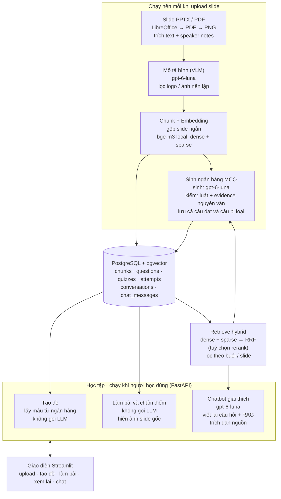

# Thiết kế MVP – RAG sinh đề trắc nghiệm và chatbot từ slide bài giảng

Cập nhật: 01/11/2026 (bỏ bước chấm lại bằng `gpt-6-sol`, thay bằng kiểm `evidence` nguyên văn)

## 1. Tổng quan MVP

MVP là một web app cho **một môn học**: nạp slide bài giảng (Việt + Anh, PPTX/PDF, có hình), hệ thống **tự sinh ngân hàng câu hỏi trắc nghiệm** 4 chọn 1 ngay sau khi nạp; người học tạo đề từ ngân hàng theo buổi / khoảng slide, làm bài, xem điểm, xem slide nguồn và hỏi chatbot về từng câu.

**Chức năng trong MVP**

1. **Nạp slide:** upload slide; hệ thống tự parse, mô tả hình bằng VLM, chunk, embed và lưu vào PostgreSQL.
2. **Sinh ngân hàng câu hỏi (tự động sau khi nạp):** LLM sinh MCQ có giải thích từng phương án, nguồn và câu trích chứng minh → hậu kiểm bằng luật (không gọi LLM) → lưu vào ngân hàng. Có thể yêu cầu sinh thêm.
3. **Tạo đề:** chọn buổi / khoảng slide + số câu + cơ cấu độ khó → lấy mẫu từ ngân hàng, trả về ngay, không gọi LLM.
4. **Làm bài:** làm hết các câu, nộp mới hiện điểm (tự luyện tập, không phải chấm điểm lớp học).
5. **Xem lại:** mỗi câu hiển thị đúng/sai, lý do đúng/sai của từng phương án, ảnh slide nguồn.
6. **Chatbot:** hỏi thêm về câu sai hoặc kiến thức bất kỳ trong môn, trả lời có trích dẫn số slide; từ chối khi tài liệu không đề cập.
7. **Đánh giá:** script chạy offline đo retrieval (có thí nghiệm reranker), chất lượng chatbot (có khả năng từ chối) và chất lượng câu hỏi.

**Quy ước ngôn ngữ:** câu hỏi, đáp án và câu trả lời chatbot viết bằng tiếng Việt, giữ nguyên thuật ngữ chuyên ngành tiếng Anh.

## 2. Kiến trúc hệ thống

Hệ thống gồm 2 pipeline quanh một PostgreSQL: pipeline **nạp slide + sinh ngân hàng câu hỏi** chạy nền mỗi khi upload, pipeline **học tập** (tạo đề, làm bài, chatbot) chạy theo yêu cầu qua FastAPI.



Sinh câu hỏi và chatbot cùng gọi một hàm `retrieve`; tạo đề và làm bài chỉ đọc DB nên không tốn lượt gọi LLM nào.

| Lớp               | Công nghệ                                                                  |
| ------------------ | ---------------------------------------------------------------------------- |
| Giao diện         | Streamlit                                                                    |
| Backend            | FastAPI (Python 3.11), Pydantic, BackgroundTasks                             |
| Parse slide        | PyMuPDF, python-pptx, LibreOffice headless                                   |
| Embedding / rerank | FlagEmbedding (bge-m3; bge-reranker-v2-m3 cho thí nghiệm)                  |
| Cơ sở dữ liệu  | PostgreSQL 16 + pgvector ≥ 0.8, SQLAlchemy + psycopg, `pgvector` (Python) |
| Gọi LLM           | LiteLLM → OpenAI API                                                        |
| Đánh giá        | RAGAS (pin version), ranx (metric retrieval), scikit-learn, `krippendorff` |
| Triển khai        | Docker Compose                                                               |

## 3. Model cho từng chức năng

MVP chỉ dùng một nhà cung cấp API (OpenAI) và model embedding / reranker chạy local. Pipeline sinh câu hỏi **không dùng LLM thứ hai để chấm lại**: `gpt-6-luna` phải trích nguyên văn câu chứng minh (`evidence`) từ slide, và luật kiểm câu trích đó (mục 7). Mỗi câu ứng viên chỉ tốn 1 lần gọi LLM. Độ tin cậy của bộ lọc được đo bằng người chấm và judge độc lập (mục 11).

| Chức năng                              | Model                                                                                 | Vì sao chọn                                                                                                                                        | Giá tham khảo (USD / 1M token, vào / ra) |
| ---------------------------------------- | ------------------------------------------------------------------------------------- | ---------------------------------------------------------------------------------------------------------------------------------------------------- | ------------------------------------------- |
| Embedding dense + sparse                 | [BAAI/bge-m3](https://huggingface.co/BAAI/bge-m3), chạy local                         | Đa ngôn ngữ, tìm được chéo Việt–Anh, sinh luôn sparse vector cho hybrid search, ngữ cảnh 8192 token, chạy được trên CPU            | Miễn phí                                  |
| Reranker (thí nghiệm)                  | [BAAI/bge-reranker-v2-m3](https://huggingface.co/BAAI/bge-reranker-v2-m3), chạy local | Cross-encoder đa ngôn ngữ, cùng họ bge-m3; chỉ xếp lại top-20 nên chạy CPU được                                                         | Miễn phí                                  |
| Mô tả slide có hình (VLM)            | `gpt-6-luna`                                                                        | Nhận ảnh, rẻ; đổi sang `gpt-6-sol` nếu mô tả kém hoặc luna không nhận ảnh                                                             | 0,10 / 0,50                                 |
| Sinh câu hỏi MCQ                       | `gpt-6-luna`                                                                        | Rẻ, nhanh, hỗ trợ JSON mode; distractor kém hơn model lớn nên dựa vào prompt theo mức Bloom, few-shot và evidence để giữ chất lượng | 0,10 / 0,50                                 |
| Hậu kiểm MCQ                           | Không dùng LLM: luật + kiểm `evidence` nguyên văn + bge-m3 chống trùng      | Rẻ, xác định, không phụ thuộc model chấm cùng họ                                                                                           | Miễn phí                                  |
| Chatbot: viết lại câu hỏi nối tiếp | `gpt-6-luna`                                                                        | Tác vụ ngắn, cần nhanh và rẻ                                                                                                                   | 0,10 / 0,50                                 |
| Chatbot: trả lời có trích dẫn       | `gpt-6-luna`                                                                        | Câu trả lời bám ngữ cảnh đã retrieve, không cần model lớn nhất                                                                           | 0,10 / 0,50                                 |
| Sinh nháp một nửa golden set          | `gpt-6-luna` + người duyệt                                                       | Cần câu hỏi đa dạng, đúng nhóm truy vấn                                                                                                     | 0,10 / 0,50                                 |
| LLM-judge (RAGAS)                        | `gpt-6-sol`                                                                         | Mạnh hơn model chatbot                                                                                                                             | 2 / 10                                      |
| Judge độc lập cho đánh giá MCQ     | `gpt-6-sol` (đổi được trong `config.yaml`)                                 | Chạy offline, bổ trợ người chấm; cùng họ với model sinh nên báo cáo phải nêu hạn chế (mục 11)                                                                                          | tuỳ model                                  |

**Nguyên tắc triển khai**

- Mọi tên model nằm trong file cấu hình (`.env` / `config.yaml`), gọi qua một lớp `llm_client` dùng LiteLLM. Đổi model hoặc nhà cung cấp không phải sửa code. `llm_client` log số token và chi phí của từng lượt gọi.
- Sinh ngân hàng câu hỏi sau khi upload dùng **API thường**, gọi song song có giới hạn (mặc định 5 request đồng thời), vì người dùng đang chờ. **Batch API** (giảm 50%) chỉ dùng cho việc không ai chờ: chạy đánh giá, sinh nháp golden set, sinh lại hàng loạt.
- Nhiệt độ: sinh MCQ 0,7 (đa dạng), VLM và judge 0 (ổn định), chatbot 0,2.
- Tên và giá model thay đổi nhanh. Các nguồn giá dưới đây là bài viết bên thứ ba; **đối chiếu trang giá chính thức** của OpenAI trước khi chạy số lượng lớn hoặc đưa vào báo cáo.

Nguồn giá (bên thứ ba): [GPT-6 Sol/Luna](https://techjacksolutions.com/?p=89514).

## 4. Cơ sở dữ liệu: PostgreSQL + pgvector

Toàn bộ dữ liệu (chunk, vector, ngân hàng câu hỏi, đề, bài làm, hội thoại) nằm trong một PostgreSQL 16 có extension `pgvector`. Vector dense 1024 chiều của bge-m3 lưu trong cột `vector`, sparse vector lưu dạng `sparsevec`.

| Bảng              | Vai trò                                                  | Cột chính                                                                                                                                                |
| ------------------ | --------------------------------------------------------- | ---------------------------------------------------------------------------------------------------------------------------------------------------------- |
| `documents`      | Mỗi file đã upload                                     | id, course_id, source_type, filename, file_path, session_no, status, error, is_active, created_at                                                          |
| `chunks`         | Đơn vị retrieve                                        | id, document_id, session_no, slide_no, slide_end, title, raw_text, notes, vlm_caption, embed_text, image_path, lang, embedding, sparse, tsv, is_active     |
| `questions`      | Ngân hàng câu hỏi (cả câu đạt và câu bị loại) | id, document_id, session_no, stem, options, answer, rationales, explanation, bloom_level, source_chunk_ids, status, validation, stem_embedding, times_used |
| `quizzes`        | Một đề đã tạo                                       | id, course_id, scope (JSONB: buổi, khoảng slide), num_questions, bloom_mix, created_at                                                                   |
| `quiz_questions` | Câu hỏi thuộc đề                                     | quiz_id, question_id, position                                                                                                                             |
| `attempts`       | Một lần làm bài                                       | id, quiz_id, user_name, answers (JSONB), score, submitted_at                                                                                               |
| `conversations`  | Một phiên chat                                          | id, attempt_id (nullable), question_id (nullable), created_at                                                                                              |
| `chat_messages`  | Lượt chat                                               | id, conversation_id, role, content, cited_chunk_ids, created_at                                                                                            |

```sql
CREATE EXTENSION IF NOT EXISTS vector;

CREATE TABLE documents (
  id           SERIAL PRIMARY KEY,
  course_id    INT,
  source_type  TEXT CHECK (source_type IN ('slide','textbook')),
  filename     TEXT NOT NULL,
  file_path    TEXT NOT NULL,
  session_no   INT,
  status       TEXT DEFAULT 'uploaded'
               CHECK (status IN ('uploaded','parsing','embedding','generating','ready','failed')),
  error        TEXT,
  is_active    BOOLEAN DEFAULT TRUE,
  created_at   TIMESTAMPTZ DEFAULT now()
);

CREATE TABLE chunks (
  id           BIGSERIAL PRIMARY KEY,
  document_id  INT REFERENCES documents(id),
  source_type  TEXT CHECK (source_type IN ('slide','textbook')),
  session_no   INT,
  slide_no     INT,                        -- slide đầu (nếu gộp nhiều slide)
  slide_end    INT,                        -- slide cuối, = slide_no nếu không gộp
  page_no      INT,                        -- dành cho giáo trình (mục 13)
  chapter_no   INT,                        -- tuỳ chọn
  title        TEXT,
  raw_text     TEXT NOT NULL,              -- text gốc, dùng để hiển thị
  notes        TEXT,                       -- speaker notes
  vlm_caption  TEXT,                       -- mô tả hình, tách riêng để làm ablation
  embed_text   TEXT NOT NULL,              -- tiền tố + raw_text + notes + vlm_caption
  image_path   TEXT,
  lang         TEXT,                       -- vi | en | mixed
  embedding    VECTOR(1024),               -- bge-m3 dense
  sparse       SPARSEVEC(250002),          -- bge-m3 sparse (vocab XLM-R)
  tsv          TSVECTOR GENERATED ALWAYS AS (to_tsvector('simple', embed_text)) STORED,
  is_active    BOOLEAN DEFAULT TRUE
);

CREATE INDEX ON chunks USING gin (tsv);
CREATE INDEX ON chunks (session_no, slide_no);
-- Không tạo HNSW ở MVP: vài nghìn chunk quét tuần tự chỉ mất vài ms và chính xác 100% khi có lọc.

CREATE TABLE questions (
  id               BIGSERIAL PRIMARY KEY,
  document_id      INT REFERENCES documents(id),
  session_no       INT,
  stem             TEXT NOT NULL,
  options          JSONB NOT NULL,         -- {"A": "...", ...} sau khi xáo
  answer           CHAR(1) CHECK (answer IN ('A','B','C','D')),
  rationales       JSONB NOT NULL,         -- {"A": "vì sao đúng/sai", ...}
  explanation      TEXT,
  bloom_level      TEXT CHECK (bloom_level IN ('remember','understand','apply')),
  source_chunk_ids BIGINT[] NOT NULL,
  status           TEXT CHECK (status IN ('accepted','rejected')),
  validation       JSONB,                  -- kết quả từng bước hậu kiểm + lý do loại
  stem_embedding   VECTOR(1024),           -- embed(stem + đáp án đúng), dùng chống trùng
  times_used       INT DEFAULT 0,
  created_at       TIMESTAMPTZ DEFAULT now()
);
```

- Dùng config `simple` cho full-text: không có từ điển tiếng Việt và **không dùng `unaccent`**, vì bỏ dấu sẽ làm "ma", "mà", "mã" trùng nhau.
- Tách `raw_text` / `notes` / `vlm_caption` / `embed_text`: giao diện hiện `raw_text`, retrieve dùng `embed_text`; thí nghiệm "có VLM / không VLM" chỉ cần dựng lại `embed_text` và embed lại, không phải parse lại.
- MVP có thể chọn **một** trong hai nhánh sparse: `sparsevec` của bge-m3 (tốt hơn với thuật ngữ) hoặc `tsvector` (đơn giản hơn). Giữ cả hai cột để so sánh trong phần đánh giá.
- `source_chunk_ids` lưu ngay lúc sinh câu hỏi, nên phần xem nguồn không phải retrieve lại. Vì mảng này không có khoá ngoại, **không xoá cứng** document / chunk: xoá hoặc thay tài liệu thì đặt `is_active = false`, câu hỏi cũ vẫn xem được nguồn.

## 5. Luồng 1: Nạp slide (ingestion)

Mọi slide đi qua cùng một pipeline chạy nền: parse → (mô tả hình nếu cần) → chunk → nhận diện ngôn ngữ → embed → lưu → **tự động chuyển sang Luồng 3 (sinh ngân hàng câu hỏi)**. `documents.status` lần lượt là `parsing → embedding → generating → ready`, lỗi ở bước nào thì `failed` kèm `error`.

**Parse**

1. PPTX → PDF bằng LibreOffice headless (`soffice --headless --convert-to pdf`). Riêng PPTX, đọc thêm speaker notes bằng `python-pptx`.
2. Với mỗi trang slide: trích text bằng PyMuPDF và render PNG (150 dpi), lưu ảnh để hiển thị khi xem nguồn.
3. Bỏ header/footer lặp (dòng xuất hiện ở ≥ 50% số slide, ví dụ tên trường, số trang).

**Mô tả hình bằng VLM**

1. Lọc ảnh trước: bỏ ảnh chiếm < 5% diện tích trang và ảnh có cùng hash xuất hiện ở ≥ 30% số slide (logo, ảnh nền template).
2. Gọi VLM khi slide **còn ảnh sau khi lọc** hoặc **có dưới 30 từ**. Prompt yêu cầu mô tả nội dung, giải thích sơ đồ/biểu đồ/bảng, giữ nguyên thuật ngữ tiếng Anh, không bịa thông tin ngoài ảnh.
3. Lưu mô tả vào `vlm_caption`.

**Chunk**

1. Mặc định mỗi slide là 1 chunk.
2. Slide có dưới 15 từ (tính cả notes và caption): cùng tiêu đề với slide liền trước thì gộp vào slide trước; khác tiêu đề (thường là slide mở mục) thì gộp vào slide đủ dài kế tiếp; slide trống hoàn toàn bị bỏ. Ghi `slide_no` – `slide_end`.
3. `embed_text = "[Buổi 5 – Slide 12] {title}\n{raw_text}\n{notes}\n{vlm_caption}"`.
4. Gán `chapter_no` là tuỳ chọn (bảng ánh xạ buổi → chương nhập tay); MVP lọc chủ yếu theo `session_no` và khoảng slide.

**Bước chung**

1. Nhận diện ngôn ngữ chunk (`vi` / `en` / `mixed`) bằng `lingua` hoặc `fasttext-langid`, dùng cho phân tích kết quả theo nhóm.
2. Embed `embed_text` bằng bge-m3 (FlagEmbedding, `return_dense=True, return_sparse=True`), batch 16–32 chunk. Sparse: `lexical_weights` có key là token id **dạng chuỗi**, ép về `int` rồi tạo `pgvector.SparseVector({int(k): v}, 250002)`; không tự dựng chuỗi text (pgvector đánh chỉ số từ 1, thư viện tự chuyển).
3. Ghi `chunks`, đặt `documents.status = 'generating'` và gọi Luồng 3.

Công việc chạy nền bằng FastAPI `BackgroundTasks` (MVP). Khi khởi động API, mọi document đang ở `parsing` / `embedding` / `generating` được đặt thành `failed` (job đã mất do restart) để người dùng chạy lại. Nếu tài liệu lớn thì chuyển sang hàng đợi (RQ / Celery).

## 6. Luồng 2: Retrieval hybrid

Một hàm `retrieve(query, filters, k, rerank=False)` dùng chung cho sinh câu hỏi, chatbot và đánh giá: chạy song song tìm kiếm dense và sparse, gộp bằng Reciprocal Rank Fusion, (tuỳ chọn) rerank, trả về top-k chunk kèm metadata.

1. **Lọc metadata:** `is_active`, `session_no IN (...)`, khoảng slide, `chapter_no` nếu có.
2. **Dense:** embed query bằng bge-m3, lấy top-20 theo cosine (quét tuần tự, xem SQL dưới).
3. **Sparse:** lấy top-20 theo inner product của sparse bge-m3 (hoặc `ts_rank` trên `tsv`). Nhánh này bắt chính xác thuật ngữ như "TF-IDF", "softmax".
4. **Gộp RRF:** điểm của mỗi chunk là tổng 1 / (60 + hạng) qua hai danh sách.
5. **Rerank (tuỳ chọn, `retrieval.rerank` trong config):** bge-reranker-v2-m3 chấm lại top-20 sau RRF. Mặc định tắt; bật nếu thí nghiệm ở mục 11 cho thấy cải thiện rõ.
6. Lấy top-k (mặc định k = 5); trả về `raw_text`, metadata (buổi, slide, image_path) và điểm.

$$
\text{RRF}(d) = \sum_{r \in \{\text{dense},\, \text{sparse}\}} \frac{1}{60 + \text{rank}_r(d)}
$$

```sql
-- Nhánh dense (:q là vector query). Không dùng HNSW nên lọc WHERE luôn đủ 20 kết quả.
SELECT id, 1 - (embedding <=> :q) AS score
FROM chunks
WHERE is_active AND session_no = ANY(:sessions)
ORDER BY embedding <=> :q
LIMIT 20;

-- Nhánh sparse bge-m3: điểm lexical là tích vô hướng; <#> trả về ÂM inner product.
SELECT id, -(sparse <#> :qs) AS score
FROM chunks
WHERE is_active AND session_no = ANY(:sessions)
ORDER BY sparse <#> :qs
LIMIT 20;

-- Nhánh tsvector (thay cho sparse bge-m3): nối từ bằng OR, không dùng plainto_tsquery (AND toàn bộ).
SELECT id, ts_rank(tsv, query) AS score
FROM chunks,
     to_tsquery('simple', array_to_string(tsvector_to_array(to_tsvector('simple', :text)), ' | ')) AS query
WHERE is_active AND session_no = ANY(:sessions) AND tsv @@ query
ORDER BY score DESC
LIMIT 20;
```

Khi dữ liệu vượt khoảng 50.000 chunk mới cần HNSW; lúc đó bật `SET LOCAL hnsw.iterative_scan = relaxed_order` (pgvector ≥ 0.8) để lọc không bị thiếu kết quả. Query expansion bằng bảng thuật ngữ Việt–Anh để ngoài MVP.

## 7. Luồng 3: Sinh ngân hàng câu hỏi và hậu kiểm

Chạy tự động ngay sau khi một file slide nạp xong (hoặc khi người dùng bấm "Sinh thêm câu hỏi"). Mỗi câu hỏi được sinh từ một chunk "hạt giống" cộng 2 chunk liên quan, bởi `gpt-6-luna`, rồi phải qua các bước kiểm tra bằng luật (không dùng LLM chấm lại). Câu trượt được sinh lại tối đa 2 lần, prompt lần sau kèm lý do trượt; vẫn trượt thì lưu với `status = 'rejected'` (giữ lại để đánh giá), không xoá.

**Cấu hình (`config.yaml`)**

```yaml
bank:
  questions_per_slide: 0.5      # 40 slide → mục tiêu 20 câu đạt
  oversample: 1.5               # số hạt giống = 1,5 × mục tiêu
  bloom_mix: {remember: 0.4, understand: 0.4, apply: 0.2}
  min_seed_words: 30            # chunk quá ít chữ không làm hạt giống
  concurrency: 5
  dedup_threshold: 0.9          # tinh chỉnh trên ~50 cặp gán nhãn tay
```

**Các bước**

1. **Chọn hạt giống:** từ các chunk của file vừa nạp có ≥ `min_seed_words` từ, chia đều theo vị trí trong bài để phủ nội dung; số hạt giống = mục tiêu × `oversample`. Gán mức Bloom cho từng hạt giống theo `bloom_mix`.
2. **Mở rộng ngữ cảnh:** với mỗi hạt giống, gọi `retrieve(embed_text của hạt giống, cùng buổi, k = 2)` (loại chính nó) để lấy thêm chunk bổ trợ.
3. **Sinh:** mỗi lần gọi `gpt-6-luna` sinh **1 câu từ 1 hạt giống** (dễ retry và log), chạy song song theo `concurrency`. Prompt kèm mức Bloom và danh sách stem đã có trong buổi đó để tránh trùng. Bắt buộc output theo JSON schema bên dưới.
4. **Hậu kiểm:**
   1. Validate schema bằng Pydantic: đúng 4 phương án, nội dung không trùng nhau, **đúng 1** phương án có `is_correct = true`, mỗi phương án có `rationale`, `source_chunk_ids` nằm trong ngữ cảnh đã đưa.
   2. Luật hình thức: cấm "tất cả đều đúng / sai", cấm phủ định kép; đáp án đúng không dài hơn 1,5 lần độ dài trung bình các đáp án sai (và hơn 4 từ); không nhắc "đáp án A", "phương án B"….
   3. **Evidence (thay cho LLM judge):** LLM phải ghi `key_point` và trích `evidence` nguyên văn từ ngữ cảnh trước khi viết câu hỏi; `evidence` phải khớp ≥ 85% ký tự (theo đoạn liên tục) với một chunk trong ngữ cảnh, nếu không → loại. `source_chunk_ids` phải có chunk hạt giống; câu hỏi không được nhắc "ngữ cảnh", "đoạn trên"; đáp án đúng không xuất hiện nguyên văn trong stem.
   4. **Chống trùng:** embed `stem + đáp án đúng`; cosine > `dedup_threshold` với một câu `accepted` bất kỳ trong cùng môn → loại.
5. **Xáo đáp án:** trộn ngẫu nhiên thứ tự phương án rồi mới gán chữ cái A–D (LLM thường dồn đáp án đúng vào A hoặc B). Vì LLM không dùng chữ cái, giải thích luôn khớp sau khi xáo.
6. **Lưu** mọi câu vào `questions` với `status` và kết quả từng bước trong `validation`. Xong thì `documents.status = 'ready'`.

```python
random.shuffle(q.options)
letters = "ABCD"
options    = {letters[i]: o.text      for i, o in enumerate(q.options)}
rationales = {letters[i]: o.rationale for i, o in enumerate(q.options)}
answer     = next(letters[i] for i, o in enumerate(q.options) if o.is_correct)
```

**JSON schema đầu ra (1 câu / lần gọi)**

```json
{
  "key_point": "string – ý kiến thức sẽ kiểm tra",
  "evidence": "string – câu trích NGUYÊN VĂN từ ngữ cảnh chứng minh đáp án đúng",
  "stem": "string – câu hỏi tiếng Việt, giữ thuật ngữ tiếng Anh",
  "options": [
    {"text": "string", "is_correct": true,  "rationale": "string – vì sao đúng"},
    {"text": "string", "is_correct": false, "rationale": "string – vì sao sai"},
    {"text": "string", "is_correct": false, "rationale": "string"},
    {"text": "string", "is_correct": false, "rationale": "string"}
  ],
  "explanation": "string – tóm tắt kiến thức, KHÔNG nhắc chữ cái A/B/C/D",
  "bloom_level": "remember | understand | apply",
  "source_chunk_ids": [123, 456]
}
```

**Prompt sinh câu hỏi (rút gọn)**: bản đầy đủ ở `app/prompts/mcq_system.txt`, `mcq_user.txt`, `mcq_bloom.json`, `few_shot.json` và `docs/tong-quan-he-thong.md` mục 5.3.

```text
[System]
Bạn là giảng viên môn {course_name}, chuyên ra đề trắc nghiệm 4 lựa chọn.
Chỉ dùng kiến thức có trong NGỮ CẢNH. Mỗi câu kiểm tra MỘT ý quan trọng.
Câu hỏi phải tự đứng được. Không có ai chấm lại câu hỏi của bạn, nên phải
tự chắc chắn: đúng 1 phương án đúng, 3 phương án còn lại chắc chắn sai.

[User]
VÍ DỤ CÂU HỎI TỐT: {few_shot – ưu tiên câu cùng mức Bloom}

NGỮ CẢNH:
<chunk id=123 nguồn="Slide buổi 5, slide 12" vai_trò="hạt giống"> ... </chunk>
<chunk id=456 nguồn="Slide buổi 5, slide 14"> ... </chunk>

NHIỆM VỤ: Viết 1 câu hỏi mức "{bloom_level}" về chunk hạt giống.
Yêu cầu riêng cho mức này: {bloom_guide}
Làm lần lượt: key_point → evidence (chép NGUYÊN VĂN) → stem → options
(4 phương án, đúng 1, phương án sai sai rõ ràng, dài tương đương) →
explanation → bloom_level → source_chunk_ids (bắt buộc có id hạt giống).
Không nhắc chữ cái A/B/C/D (thứ tự sẽ được xáo).
KHÔNG trùng ý với các câu đã có: {existing_stems}
{feedback – lý do trượt của lần trước, nếu là lần sinh lại}
```

## 8. Luồng 4: Tạo đề, làm bài, chấm điểm, xem nguồn

Luồng này không gọi LLM: đề lấy mẫu từ ngân hàng, chấm điểm là so khớp, nguồn lấy theo `source_chunk_ids` đã lưu.

**Tạo đề**

1. Người học chọn phạm vi (một hoặc nhiều buổi, hoặc khoảng slide), số câu N, cơ cấu Bloom.
2. Lấy các câu `accepted` có chunk nguồn nằm trong phạm vi; chia theo mức Bloom theo tỉ lệ, trong mỗi mức chọn xoay vòng theo slide nguồn để phủ đều, ưu tiên câu có `times_used` thấp.
3. Ngân hàng không đủ N câu → tạo đề với số câu hiện có và báo cho người dùng, kèm nút "Sinh thêm câu hỏi" (gọi lại Luồng 3 cho phạm vi đó, chạy nền).
4. Lưu `quizzes` + `quiz_questions`, tăng `times_used`.

**Làm bài và xem lại**

1. Client nhận câu hỏi và phương án, **không** nhận `answer`, `rationales`, `explanation`.
2. Chọn đáp án cho từng câu; trạng thái lưu trong `st.session_state`. Nút Nộp chỉ bật khi đã trả lời hết.
3. Nộp → server chấm, lưu `attempts`, trả về điểm (số câu đúng / N và thang 10).
4. Màn hình xem lại, mỗi câu hiển thị:
   - Đáp án đã chọn và đáp án đúng (xanh / đỏ).
   - Lý do đúng/sai của **từng** phương án (`rationales`) và giải thích chung.
   - **Nguồn:** ảnh slide gốc (`image_path`) kèm buổi và số slide.
   - Nút **Hỏi chatbot về câu này** → mở chatbot với ngữ cảnh câu hỏi đã nạp sẵn.

## 9. Luồng 5: Chatbot giải thích có trích dẫn

Chatbot là RAG hội thoại dùng `gpt-6-luna`, có hai chế độ: hỏi về một câu cụ thể (mở từ màn xem lại, tạo `conversation` gắn `attempt_id` + `question_id`) và hỏi tự do về môn học (`conversation` không gắn câu nào). Mọi câu trả lời phải dẫn nguồn và chỉ dựa trên tài liệu đã retrieve.

**Mỗi lượt hỏi**

1. **Lấy lịch sử:** 4 lượt gần nhất của `conversation_id`.
2. **Viết lại câu hỏi** (`gpt-6-luna`): biến câu nối tiếp như "thế còn cái kia?" thành câu hỏi độc lập. Bỏ qua nếu là lượt đầu.
3. **Retrieve:** `retrieve(câu đã viết lại, k = 5)`. Ở chế độ hỏi về một câu cụ thể, lọc theo buổi của câu và đặt các chunk trong `source_chunk_ids` lên đầu; khử trùng lặp, tối đa 7 chunk.
4. **Từ chối sớm:** nếu điểm dense của chunk tốt nhất < `chat.min_dense_score` (tinh chỉnh trên bộ câu ngoài phạm vi ở mục 11), trả lời ngay "tài liệu môn học không đề cập" mà không gọi LLM.
5. **Dựng prompt:** system prompt + (câu hỏi MCQ, đáp án người học chọn, đáp án đúng, lý do, nếu có) + các chunk **đánh số động** `[1]`…`[n]` kèm nguồn + 4 lượt gần nhất + câu hỏi hiện tại.
6. **Sinh câu trả lời** (stream về client), gắn trích dẫn dạng `[2]`; client hiển thị `[2]` thành link tới ảnh slide.
7. **Lưu** vào `chat_messages` cùng `cited_chunk_ids` (phục vụ đánh giá).

**Quy tắc trong system prompt**

- Chỉ trả lời dựa trên các đoạn được cung cấp; không đủ thông tin thì nói rõ là tài liệu môn học không đề cập.
- Mỗi ý chính có ít nhất một trích dẫn.
- Khi giải thích câu sai: nêu vì sao đáp án đã chọn sai, rồi vì sao đáp án đúng đúng.
- Tiếng Việt, giữ thuật ngữ tiếng Anh.

## 10. API và cấu trúc code

Backend FastAPI cung cấp 10 endpoint; frontend Streamlit gọi các endpoint này, không truy cập DB trực tiếp.

| Method | Endpoint                               | Việc làm                                                                                                    |
| ------ | -------------------------------------- | ------------------------------------------------------------------------------------------------------------- |
| POST   | `/documents`                         | Upload file (session_no), chạy nền ingestion → sinh ngân hàng câu hỏi                                  |
| GET    | `/documents/{id}`                    | Trạng thái (`parsing` … `ready` / `failed` + error), số chunk, số câu đạt / bị loại           |
| POST   | `/documents/{id}/questions/generate` | Sinh thêm câu hỏi cho file / khoảng slide (chạy nền)                                                    |
| POST   | `/search`                            | Gọi `retrieve` (dùng để debug và đánh giá)                                                          |
| POST   | `/quizzes`                           | Tạo đề: scope, n, bloom_mix → quiz_id, số câu thực có                                                 |
| GET    | `/quizzes/{id}`                      | Câu hỏi + phương án (không kèm đáp án)                                                              |
| POST   | `/attempts`                          | Nộp bài: quiz_id, answers → điểm, attempt_id                                                             |
| GET    | `/attempts/{id}/review`              | Đáp án, lý do từng phương án, nguồn từng câu                                                       |
| POST   | `/chat`                              | conversation_id?, attempt_id?, question_id?, message → conversation_id + câu trả lời stream + trích dẫn |
| GET    | `/chunks/{id}/image`                 | Ảnh slide nguồn                                                                                             |

```text
Project_NLP/
├── app/                        # BACKEND (FastAPI)
│   ├── main.py                 # tạo app, gắn router, dọn job dở dang, nạp sẵn bge-m3
│   ├── config.py               # Settings (.env) + AppConfig (config.yaml)
│   ├── db.py, models.py        # SQLAlchemy engine + ORM
│   ├── schemas.py              # Pydantic: API vào/ra + output LLM sinh MCQ
│   ├── llm_client.py           # LiteLLM wrapper, model theo vai trò, log token/chi phí
│   ├── api/                    # documents, search, quizzes, attempts, chat, chunks
│   ├── ingestion/              # pipeline, slide_parser, image_filter, vlm_caption, chunker, lang_detect
│   ├── retrieval/              # embedder (bge-m3), hybrid (dense + sparse + RRF), reranker
│   ├── generation/             # common (xáo đáp án, chia Bloom), bank_builder, validator, quiz_sampler
│   ├── chat/                   # rewriter, answerer
│   └── prompts/                # *.txt + few_shot.json (3–5 câu MCQ tham chiếu viết tay), render()
├── ui/                         # FRONTEND (Streamlit)
│   ├── streamlit_app.py        # trang chủ
│   ├── api_client.py           # gọi backend qua httpx
│   ├── views/                  # left (tải slide), center (xem slide), chat, quiz (tạo đề, làm bài, xem lại)
│   └── assets/                 # logo ICTU
├── eval/                       # eval_retrieval, eval_ragas, mcq/, golden_set/, mcq_reference/, results/
├── migrations/001_init.sql     # schema (nguồn chuẩn), chạy khi khởi tạo container db
├── docker/                     # api.Dockerfile (LibreOffice + font VN), ui.Dockerfile
├── requirements/               # api.txt, ui.txt, eval.txt
├── data/                       # uploads/, renders/
├── docker-compose.yml          # db (pgvector/pgvector:pg16), api :8000, ui :8501
├── config.yaml                 # tên model + tham số thuật toán
└── .env / .env.example         # API key, kết nối DB, đường dẫn
```

## 11. Đánh giá MVP

Đánh giá chạy offline bằng script trong `eval/`, gồm 3 tầng: retrieval, câu trả lời chatbot và chất lượng câu hỏi.

**Dữ liệu đánh giá**

| Bộ                       | Quy mô    | Cách xây                                                                                                               |
| ------------------------- | ---------- | ------------------------------------------------------------------------------------------------------------------------ |
| Golden set – viết tay   | ~50 câu   | Thành viên tự viết câu hỏi + câu trả lời tham chiếu + slide chứa đáp án, không nhìn kết quả hệ thống |
| Golden set – LLM nháp   | ~50 câu   | `gpt-6-luna` sinh nháp từ chunk chọn ngẫu nhiên (Batch API), nhóm duyệt tay, sửa hoặc loại                   |
| Câu ngoài phạm vi      | ~20 câu   | Câu cùng chủ đề môn nhưng slide không đề cập, dùng đo khả năng từ chối                                  |
| MCQ tham chiếu viết tay | ≥ 50 câu | 3–5 câu làm few-shot cho prompt sinh; phần còn lại trộn mù với câu hệ thống sinh khi cho người chấm       |

- **Báo cáo kết quả golden set tách riêng hai phần** (viết tay / LLM nháp): câu LLM sinh từ chunk thường trùng từ với chunk, làm điểm retrieval, nhất là nhánh sparse, cao hơn thực tế.
- **Gán chunk đúng bằng pooling:** gộp top-10 của dense, sparse, hybrid và hybrid + rerank, người gán đánh dấu mọi chunk liên quan. Không chỉ xem kết quả của một cấu hình, để tránh thiên vị cấu hình đó.
- Chia đều theo 5 nhóm truy vấn (mỗi nhóm khoảng 20 câu, trộn cả hai phần):

| Nhóm truy vấn                      | Ví dụ                                                 |
| ------------------------------------ | ------------------------------------------------------- |
| Việt → slide Việt                 | Hàm kích hoạt là gì?                               |
| Anh → slide Anh                     | What is dropout?                                        |
| Trộn Việt–Anh                     | Gradient vanishing xảy ra khi nào?                    |
| Hỏi Việt, đáp án ở slide Anh   | Cơ chế chú ý hoạt động thế nào?                |
| Nội dung chỉ có trong hình slide | Sơ đồ kiến trúc ở buổi 4 gồm những khối nào? |

Nhóm "Việt → slide Việt" cần bộ slide có tiếng Việt thật. Chốt bộ slide (5–10 bài) sớm; nếu corpus chỉ có tiếng Anh thì bỏ nhóm này và ghi rõ trong báo cáo.

**Tầng 1 – Retrieval** (`eval_retrieval.py`)

- Metric: Hit@5, Recall@5, MRR@10, nDCG@10; báo cáo tổng, theo từng nhóm và theo phần (viết tay / LLM nháp).
- Thí nghiệm: dense / sparse bge-m3 / tsvector / hybrid / **hybrid + rerank**; slide có mô tả VLM / chỉ text slide. Biến thể "không VLM" embed lại `embed_text` bỏ `vlm_caption` và tính trong bộ nhớ (numpy), không cần ghi đè DB.

**Tầng 2 – Câu trả lời chatbot** (`eval_ragas.py`)

- RAGAS với `gpt-6-sol` làm judge: Faithfulness, Answer Relevancy, Context Precision, Context Recall. Cấu hình embedding của RAGAS là bge-m3 (mặc định nó gọi embedding của OpenAI); pin version RAGAS.
- **Khả năng từ chối** trên 20 câu ngoài phạm vi + toàn bộ golden set: tỉ lệ từ chối đúng (câu ngoài phạm vi) và tỉ lệ từ chối nhầm (câu trong phạm vi). Dùng kết quả này để chọn `chat.min_dense_score`.
- Chấm tay 30 câu (đúng / một phần / sai) để kiểm tra điểm judge có khớp người chấm không.

**Tầng 3 – Chất lượng câu hỏi MCQ** (`eval/mcq/`, làm trước hai tầng trên; các bước và lệnh chạy xem `eval/mcq/README.md`)

Bộ lọc ở mục 7 chỉ dùng luật, nên cần đo độc lập xem luật có bỏ sót câu sai kiến thức hoặc có nhiều hơn 1 đáp án đúng hay không. Không dùng `gpt-6-luna` (model sinh) để đo. Đo trên **toàn bộ câu ứng viên** (cả `accepted` lẫn `rejected`) của pipeline hiện tại, sau khi đóng băng thành snapshot.

| Metric                         | Cách đo                                                                                                                                                                                                                                                                                                                         |
| ------------------------------ | --------------------------------------------------------------------------------------------------------------------------------------------------------------------------------------------------------------------------------------------------------------------------------------------------------------------------------- |
| Tỉ lệ qua hậu kiểm         | Số câu `accepted` / số câu sinh ra; thống kê lý do loại theo `validation`                                                                                                                                                                                                                                             |
| Độ chính xác của bộ lọc | Người chấm ~60 câu ứng viên (trộn đạt và bị loại, không biết kết quả lọc) → precision / recall của bộ lọc so với người                                                                                                                                                                                    |
| Answerability độc lập       | Judge (`models.judge_independent`, mặc định `gpt-6-sol`, cùng họ với model sinh nên chỉ bổ trợ người chấm) trả lời câu `accepted` khi có ngữ cảnh, prompt `prompts/answerability.txt`. Chính judge được đo bằng cách so với người chấm, thử cài lỗi, thử sai ngữ cảnh và độ ổn định                                                                                                                                                                       |
| Tỉ lệ trùng                 | % cặp câu `accepted` trong cùng buổi có cosine > ngưỡng                                                                                                                                                                                                                                                                  |
| Phân bố vị trí đáp án   | Tỉ lệ A/B/C/D sau khi xáo, kỳ vọng gần 25% mỗi loại                                                                                                                                                                                                                                                                       |
| Đánh giá người            | 2 người chấm độc lập chung mẫu ở dòng "Độ chính xác của bộ lọc". Đạt/lỗi: đúng kiến thức, đúng 1 đáp án đúng, evidence chứng minh được đáp án, câu tự đứng được. Thang 1–5: rõ ràng, đáp án sai hợp lý, đúng mức Bloom. Độ đồng thuận: Cohen's kappa cho đạt/lỗi, weighted kappa (`weights="quadratic"`) cho thang 1–5. Trộn mù với câu MCQ viết tay là phần làm thêm nếu còn thời gian |

## 12. Chi phí, rủi ro và thứ tự triển khai

Chi phí API cho toàn bộ project ước tính dưới 25 USD. Giả định: 15 buổi × 40 slide (600 slide), khoảng một nửa còn ảnh sau khi lọc, ngân hàng khoảng 300 câu đạt (450 hạt giống, tính cả retry), 1.000 lượt chat, chạy đánh giá 3 lần.

| Hạng mục                                                                         | Model                         | Ước tính (USD) |
| ---------------------------------------------------------------------------------- | ----------------------------- | ----------------- |
| Mô tả ~300 slide có hình                                                       | gpt-6-luna                    | dưới 0,5        |
| Sinh ngân hàng ~300 câu (kể cả retry, sinh thêm; hậu kiểm không gọi LLM) | gpt-6-luna                    | dưới 1          |
| 1.000 lượt chatbot                                                               | gpt-6-luna                    | dưới 1          |
| Golden set nháp + 3 lần chạy RAGAS + judge MCQ                                  | gpt-6-luna, gpt-6-sol (Batch) | khoảng 10–15    |

Đây là ước tính theo token trung bình, không phải số đo; log token thực tế qua `llm_client` để báo cáo chính xác.

**Rủi ro và cách xử lý**

| Rủi ro                                           | Cách xử lý                                                                                                                                  |
| ------------------------------------------------- | ---------------------------------------------------------------------------------------------------------------------------------------------- |
| VLM mô tả bịa nội dung không có trong slide | Prompt cấm suy đoán; kiểm tra tay ngẫu nhiên 20 slide                                                                                    |
| Logo / ảnh nền làm VLM chạy trên mọi slide  | Lọc theo diện tích và hash lặp (mục 5)                                                                                                   |
| Nhiều câu hỏi bị loại ở hậu kiểm          | Lý do trượt được đưa vào prompt lần sinh lại; tăng `oversample`; chỉnh prompt theo thống kê lý do loại trong `validation` |
| Người dùng chờ lâu sau khi upload            | Sinh song song, hiển thị tiến độ qua `GET /documents/{id}`; câu hỏi đạt được lưu dần nên có thể tạo đề khi chưa xong    |
| bge-m3 chậm trên CPU                            | Embed lần đầu trên Colab GPU rồi nạp vào DB; query lúc chạy chỉ 1 câu nên CPU vẫn đủ                                            |
| Job nền mất khi restart                         | Đặt document dở dang thành `failed` khi khởi động, cho chạy lại                                                                     |
| LibreOffice render sai chữ tiếng Việt          | Cài font (`fonts-noto`, `fonts-dejavu`) trong image Docker                                                                                |
| Free tier bị giới hạn tốc độ                | Dùng paid tier; giới hạn `concurrency`; Batch API cho việc không ai chờ                                                                |
| Model bị đổi tên hoặc ngừng hỗ trợ        | Tên model nằm trong config, đổi không cần sửa code                                                                                      |

**Thứ tự triển khai**

1. Hạ tầng: docker-compose (Postgres + pgvector, font tiếng Việt cho LibreOffice, volume cache HuggingFace), schema, `llm_client`, config.
2. Ingestion slide: PPTX → PDF, render ảnh, lọc ảnh, VLM caption, gộp slide ngắn, embed; kiểm tra bằng `/search`.
3. Retrieval hybrid; song song viết ~50 câu golden set bằng tay; chạy `eval_retrieval.py` sớm để chọn cấu hình.
4. Sinh ngân hàng câu hỏi + hậu kiểm, nối vào cuối ingestion.
5. Tạo đề từ ngân hàng, UI làm bài, chấm điểm, xem nguồn.
6. Chatbot (conversation, từ chối sớm, trích dẫn).
7. Hoàn thiện golden set + câu ngoài phạm vi + MCQ tham chiếu; đánh giá đầy đủ 3 tầng và thí nghiệm rerank; viết báo cáo.
8. *(Nếu còn thời gian)* Giáo trình PDF theo mục 13.

## 13. Mở rộng: nạp giáo trình PDF

Không nằm trong MVP. Schema đã sẵn `source_type = 'textbook'`, `page_no`, `chapter_no` nên khi làm chỉ cần thêm parser và bảng `sections`.

| Bảng thêm  | Cột chính                                               |
| ------------ | --------------------------------------------------------- |
| `sections` | id, document_id, chapter_no, title, parent_id, start_page |

1. Parse bằng **Docling** để giữ heading, bảng, công thức; fallback PyMuPDF nếu Docling lỗi.
2. Dựng cây chương → mục từ heading hoặc mục lục PDF; nếu Docling nhận sai heading tiếng Việt thì nhập tay danh sách chương + trang bắt đầu.
3. Chunk trong phạm vi từng mục, 300–500 token (theo tokenizer bge-m3), overlap khoảng 50 token, không cắt giữa bảng hoặc công thức.
4. `embed_text` có tiền tố `[Chương 3 > 3.2 Backpropagation]`.
5. Trang có sơ đồ / biểu đồ: render PNG, gửi VLM như slide, lưu vào `vlm_caption`.
6. Gán `chapter_no` cho slide bằng bảng ánh xạ buổi → chương để tạo đề và chatbot lọc được theo chương trên cả hai nguồn.
